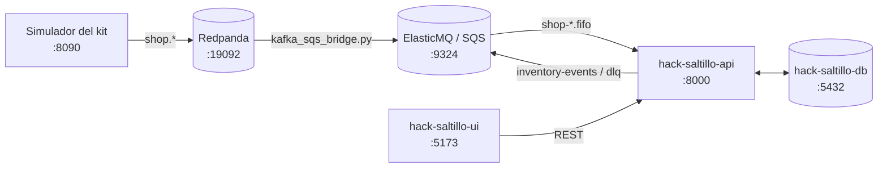

# hack-saltillo-broker

Colas de mensajes del servicio de inventario **Roceel** (reto *Almacén inteligente para taller*,
HackITS 2026). Por aquí pasan los eventos del taller hacia la API y los eventos de inventario que
publica la API.

- **En AWS:** siete colas **SQS FIFO** creadas con Terraform y desplegadas por GitHub Actions con OIDC
  (sin access keys guardadas en GitHub).
- **En local:** **ElasticMQ**, un emulador de SQS en Docker (`localhost:9324`). El `compose.yaml` también
  trae un Redpanda por si no usas el del kit.

## Contenido

1. [El sistema completo](#el-sistema-completo)
2. [Colas](#colas)
3. [Correr en local](#correr-en-local)
4. [Conectar con los demás repos](#conectar-con-los-demás-repos)
5. [Desplegar en AWS](#desplegar-en-aws)
6. [Límites](#límites)

## El sistema completo

| Repo | Qué hace | En local |
|---|---|---|
| [`hack-saltillo-db`](https://github.com/AgustinReyesC/hack-saltillo-db) | PostgreSQL 16: esquema, migraciones (Liquibase) y catálogo semilla. | `localhost:5432` |
| **`hack-saltillo-broker`** (este) | Colas SQS FIFO: Terraform para AWS y ElasticMQ para local. | `localhost:9324` |
| [`hack-saltillo-api`](https://github.com/AgustinReyesC/hack-saltillo-api) | Servicio de inventario (NestJS): consume las colas, lleva el libro mayor, publica `stock.*` y expone REST y WebSocket. | `localhost:8000` (HTTP), `:8443` (HTTPS) |
| [`hack-saltillo-ui`](https://github.com/AgustinReyesC/hack-saltillo-ui) | Pantallas (React + Vite): dashboard, piso con escaneo, órdenes y resolución. | `localhost:5173` |
| [`hack-saltillo-events`](https://github.com/AgustinReyesC/hack-saltillo-events) | Prototipo del agente de IA (Gemini). Aún no se conecta a la API. | proceso de consola |
| `hackathon-inventario-kit` | Kit del reto (no es repo del equipo): Redpanda, simulador, contrato y pruebas de contrato. | `:19092` Kafka, `:8080` consola, `:8090` simulador |



El simulador y las pruebas de contrato del kit solo hablan **Kafka**; la API solo habla **SQS**. En
local los une el puente `kafka_sqs_bridge.py` (ver [Conectar con los demás repos](#conectar-con-los-demás-repos)).
El orden completo para levantar todo está en el
[README de la API](https://github.com/AgustinReyesC/hack-saltillo-api#levantar-todo-el-sistema-en-local).

## Colas

Una cola FIFO por tópico del contrato, más la de notificaciones del agente. Todas llevan el prefijo
`inventory-broker-` (variable `project_name`).

| Cola | Tópico lógico | Dirección | Quién escribe | Quién lee |
|---|---|---|---|---|
| `inventory-broker-shop-catalog.fifo` | `shop.catalog` | entrada | Simulador (vía puente) | API |
| `inventory-broker-shop-work-orders.fifo` | `shop.work_orders` | entrada | Simulador (vía puente) | API |
| `inventory-broker-shop-inspections.fifo` | `shop.inspections` | entrada | Simulador (vía puente) | API |
| `inventory-broker-shop-purchasing.fifo` | `shop.purchasing` | entrada | Simulador (vía puente) | API |
| `inventory-broker-notifications.fifo` | `notifications` | entrada | Mensajes del usuario al agente | API |
| `inventory-broker-inventory-events.fifo` | `inventory.events` | salida | API (`stock.*`) | Puente → Kafka (pruebas de contrato) |
| `inventory-broker-inventory-dlq.fifo` | `inventory.dlq` | salida | API (eventos que no pudo procesar) | Puente → Kafka |

Atributos (iguales en AWS y en local):

| Atributo | Valor |
|---|---|
| `FifoQueue` | `true` |
| `ContentBasedDeduplication` | `false`: cada envío debe traer `MessageDeduplicationId` |
| `VisibilityTimeout` | 60 s |
| `MessageRetentionPeriod` | 1,209,600 s (14 días) |
| `ReceiveMessageWaitTimeSeconds` | 20 s (*long polling*) |
| Cifrado | SSE administrado por SQS (solo en AWS) |

Formato de cada mensaje:

- **Cuerpo:** el sobre del evento tal cual (`{"event_id", "event_type", ..., "data"}`) o envuelto como
  `{"topic": "...", "event": {...}}`. La API acepta los dos.
- **`MessageGroupId`:** la `key` del evento (`part:305`, `R061026012`, `PR-2044`…). SQS FIFO garantiza el
  orden dentro de cada grupo, igual que Kafka dentro de una llave.
- **`MessageDeduplicationId`:** el `event_id`, o un valor único por envío si se quiere que los reenvíos
  del mismo `event_id` lleguen a la API (así lo hace el puente, para que la idempotencia la demuestre la
  API y no SQS).
- El consumidor borra el mensaje (`DeleteMessage`) después de guardarlo; si no lo borra, SQS lo vuelve a
  entregar cuando vence el *visibility timeout*.

## Correr en local

### Requisitos

- Docker y Docker Compose v2 (Docker Desktop, o Docker Engine en WSL2).
- Opcional: [AWS CLI v2](https://aws.amazon.com/cli/) para crear y revisar colas, y Python 3.10+ con
  `confluent-kafka` y `boto3` para el puente.

### 1. Levantar ElasticMQ

```bash
docker compose up -d elasticmq
```

| Servicio de `compose.yaml` | Puerto | Para qué |
|---|---|---|
| `elasticmq` | `9324` | Emulador de SQS. Región `us-west-2`, cuenta `000000000000`. Guarda los mensajes en el volumen `elasticmq-data`. |
| `redpanda` | `19092` | Kafka. **Solo** si no usas el Redpanda del kit: los dos usan el puerto 19092. |
| `console` | `8081` | Consola de Redpanda (la del kit usa el 8080). |

Con el kit levantado, arranca solo `elasticmq`. `docker compose up -d` a secas levanta los tres servicios y
choca con el Redpanda del kit.

### 2. Crear las colas

ElasticMQ arranca sin colas. El puente las crea al iniciar; sin el puente, créalas con la AWS CLI.
Crear una cola que ya existe con los mismos atributos no falla, así que puedes correrlo cada vez:

```bash
export AWS_ACCESS_KEY_ID=test AWS_SECRET_ACCESS_KEY=test AWS_DEFAULT_REGION=us-west-2
for q in shop-catalog shop-work-orders shop-inspections shop-purchasing notifications inventory-events inventory-dlq; do
  aws --endpoint-url http://localhost:9324 sqs create-queue \
    --queue-name "inventory-broker-$q.fifo" \
    --attributes FifoQueue=true,ContentBasedDeduplication=false,VisibilityTimeout=60,MessageRetentionPeriod=1209600,ReceiveMessageWaitTimeSeconds=20
done
aws --endpoint-url http://localhost:9324 sqs list-queues
```

Las URLs quedan así:

```text
http://localhost:9324/000000000000/inventory-broker-<nombre>.fifo
```

Las credenciales `test` solo sirven con el emulador.

### 3. Probar una cola a mano (opcional)

Con la API corriendo y conectada a ElasticMQ, manda un `location.upserted` y búscalo en la API:

```bash
aws --endpoint-url http://localhost:9324 sqs send-message \
  --queue-url http://localhost:9324/000000000000/inventory-broker-shop-catalog.fifo \
  --message-group-id location:999 \
  --message-deduplication-id "prueba-$RANDOM$RANDOM" \
  --message-body '{"event_id":"8f6d2c1a-3b4e-4f5a-9c7d-1e2f3a4b5c6d","event_type":"location.upserted","event_version":1,"occurred_at":"2026-10-10T12:00:00Z","source":"shop-floor","key":"location:999","data":{"location_id":999,"code":"U-999","name":"Prueba local","is_workbench":false,"active":true}}'

curl "http://localhost:8000/locations?code=U-999"
```

### Detener y reiniciar

```bash
docker compose stop elasticmq      # conserva colas y mensajes
docker compose down -v             # borra el volumen elasticmq-data (mensajes)
```

Después de un `down -v`, vuelve a crear las colas (paso 2 o arrancando el puente).

## Conectar con los demás repos

### API (`hack-saltillo-api`)

La API lee las URLs de las colas de sus variables de entorno. En su `.env.local`:

```dotenv
AWS_REGION=us-west-2
AWS_ACCESS_KEY_ID=test
AWS_SECRET_ACCESS_KEY=test
SQS_ENDPOINT_URL=http://localhost:9324
SQS_SHOP_CATALOG_URL=http://localhost:9324/000000000000/inventory-broker-shop-catalog.fifo
SQS_SHOP_WORK_ORDERS_URL=http://localhost:9324/000000000000/inventory-broker-shop-work-orders.fifo
SQS_SHOP_INSPECTIONS_URL=http://localhost:9324/000000000000/inventory-broker-shop-inspections.fifo
SQS_SHOP_PURCHASING_URL=http://localhost:9324/000000000000/inventory-broker-shop-purchasing.fifo
SQS_NOTIFICATIONS_URL=http://localhost:9324/000000000000/inventory-broker-notifications.fifo
SQS_INVENTORY_EVENTS_URL=http://localhost:9324/000000000000/inventory-broker-inventory-events.fifo
SQS_INVENTORY_DLQ_URL=http://localhost:9324/000000000000/inventory-broker-inventory-dlq.fifo
```

La API solo consume las colas de entrada. Las de salida son para otros consumidores: en SQS cada mensaje lo
recibe un solo consumidor, así que conecta **una sola** API a la vez.

### Simulador y pruebas de contrato del kit (puente Kafka ↔ SQS)

El simulador del kit publica solo en Kafka y las pruebas de contrato leen solo de Kafka. El puente
`kafka_sqs_bridge.py` traslada los mensajes en los dos sentidos:

```text
shop.catalog / shop.work_orders / shop.inspections / shop.purchasing   (Kafka)  →  inventory-broker-shop-*.fifo   (SQS)
inventory-broker-inventory-events.fifo / -inventory-dlq.fifo           (SQS)    →  inventory.events / inventory.dlq (Kafka)
```

Hoy el puente está en la copia local del kit (`hackathon-inventario-kit/pruebas-locales/kafka_sqs_bridge.py`)
y no está versionado en ningún repo del equipo.

```bash
pip install confluent-kafka boto3
cd hackathon-inventario-kit/pruebas-locales
python -u kafka_sqs_bridge.py                               # crea las 7 colas y traslada
python -u kafka_sqs_bridge.py --group relectura-1 --purge   # vacía las colas y relee Kafka desde el inicio
```

| Opción | Valor por defecto | Para qué |
|---|---|---|
| `--broker` | `localhost:19092` | Kafka (Redpanda del kit). |
| `--sqs-endpoint` | `http://localhost:9324` | ElasticMQ. |
| `--region` | `us-west-2` | Región del emulador. |
| `--prefix` | `inventory-broker` | Prefijo de las colas. |
| `--group` | `sqs-bridge` | Grupo de consumo de Kafka; uno nuevo relee los tópicos desde el inicio. |
| `--purge` | | Vacía las colas al arrancar (reconstrucción). |
| `--log <archivo>` | | Copia la salida a un archivo. |
| `--verbose` | | Una línea por mensaje trasladado. |

Los tópicos de Kafka deben existir antes de arrancar el puente. Los crea el simulador del kit, o a mano desde
la carpeta del kit:

```bash
docker compose exec redpanda rpk topic create shop.catalog shop.work_orders shop.inspections shop.purchasing inventory.events inventory.dlq -p 3
```

El puente usa credenciales `test` fijas: solo funciona contra ElasticMQ, no contra las colas de AWS.

## Desplegar en AWS

### 1. Bootstrap único (state de Terraform y rol OIDC)

`bootstrap/` crea el bucket S3 del state (cifrado, versionado y sin acceso público), el proveedor OIDC de
GitHub y el rol `inventory-broker-github-deploy`, limitado al repositorio y la rama que indiques. Ejecútalo
con un perfil local que pueda crear recursos de IAM y S3:

```bash
cp bootstrap/terraform.tfvars.example bootstrap/terraform.tfvars
# Edita aws_region, github_repository (OWNER/REPOSITORY) y github_branch.
terraform -chdir=bootstrap init
terraform -chdir=bootstrap apply
```

Para repositorios de GitHub creados después del 15 de julio de 2026, llena también `github_owner_id` y
`github_repository_id`: GitHub usa esos IDs en el `sub` inmutable del token OIDC.

Si la cuenta ya tiene el proveedor OIDC `token.actions.githubusercontent.com`, impórtalo antes de aplicar:

```bash
ACCOUNT_ID="$(aws sts get-caller-identity --query Account --output text)"
terraform -chdir=bootstrap import aws_iam_openid_connect_provider.github \
  "arn:aws:iam::${ACCOUNT_ID}:oidc-provider/token.actions.githubusercontent.com"
```

En **Settings → Secrets and variables → Actions → Variables** del repo:

| Variable | Valor |
|---|---|
| `AWS_ROLE_TO_ASSUME` | Output `github_deploy_role_arn` |
| `AWS_REGION` | Región de las colas. Debe ser la misma de la API: la API busca las colas por nombre en su región. |
| `TF_STATE_BUCKET` | Output `terraform_state_bucket` |

El rol tiene `PowerUserAccess`, que es amplio; para producción conviene una política de mínimo privilegio.

### 2. Despliegue

`.github/workflows/deploy-broker.yml` corre en cada push a `main` y a mano (`workflow_dispatch`): se
autentica por OIDC, hace `terraform init` (llave `broker/terraform.tfstate`), `validate`, `plan` y `apply`, e
imprime el output `sqs_queue_urls`.

| Output | Contenido |
|---|---|
| `sqs_queue_urls` | URL de cada cola, por tópico lógico (`shop.catalog`, `inventory.events`, …). |
| `sqs_queue_arns` | ARN de cada cola, por tópico lógico. |

Para leerlos desde tu máquina:

```bash
terraform init \
  -backend-config="bucket=$TF_STATE_BUCKET" \
  -backend-config="key=broker/terraform.tfstate" \
  -backend-config="region=$AWS_REGION" \
  -backend-config="encrypt=true" \
  -backend-config="use_lockfile=true"
terraform output -json sqs_queue_urls
```

La API desplegada (`hack-saltillo-api/infra`) encuentra las colas por nombre, así que el broker debe estar
desplegado antes que la API, en la misma cuenta y región.

Si este mismo state tenía la infraestructura anterior con MSK, el plan elimina MSK, VPC, VPN, KMS y Secrets
Manager y crea las colas. Revisa el plan antes de aplicarlo: destruir MSK borra sus datos.

### Destruir

`terraform destroy` con el mismo backend y región elimina las colas y los mensajes que tengan. El bucket y el
state del bootstrap se conservan.

## Límites

- SQS retiene cada mensaje hasta 14 días y lo borra al consumirlo: no se puede releer desde el inicio como en
  Kafka. Para reconstruir la base hay que releer desde Kafka (puente con `--group` nuevo y `--purge`).
- El orden está garantizado dentro de cada grupo de mensajes, no entre colas.
- El nivel gratuito de AWS indica hasta 1 millón de solicitudes SQS al mes; verifica las condiciones en tu
  cuenta y región.